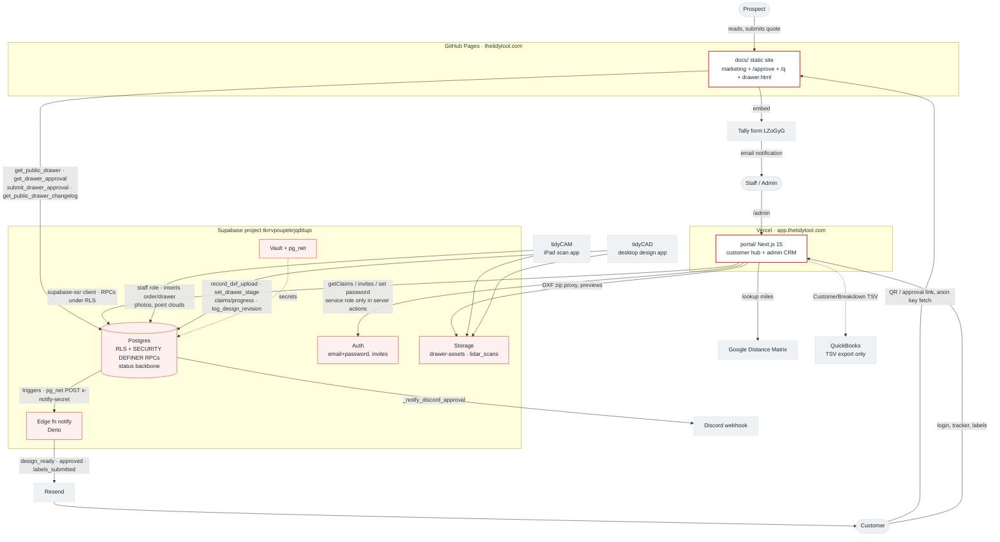
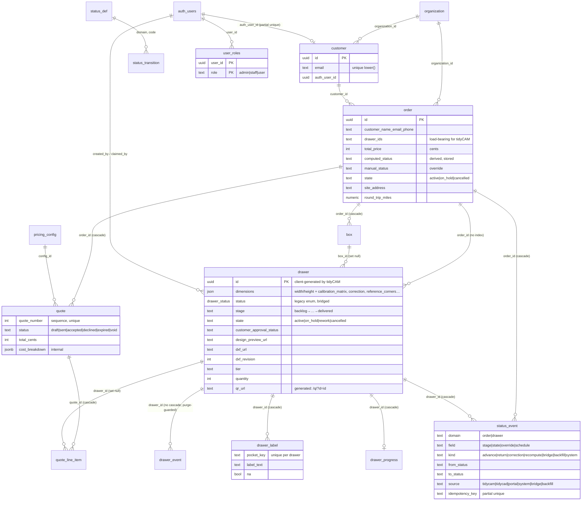
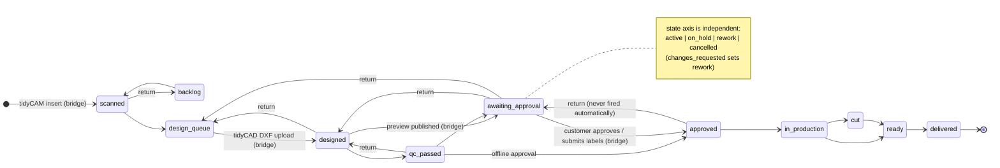
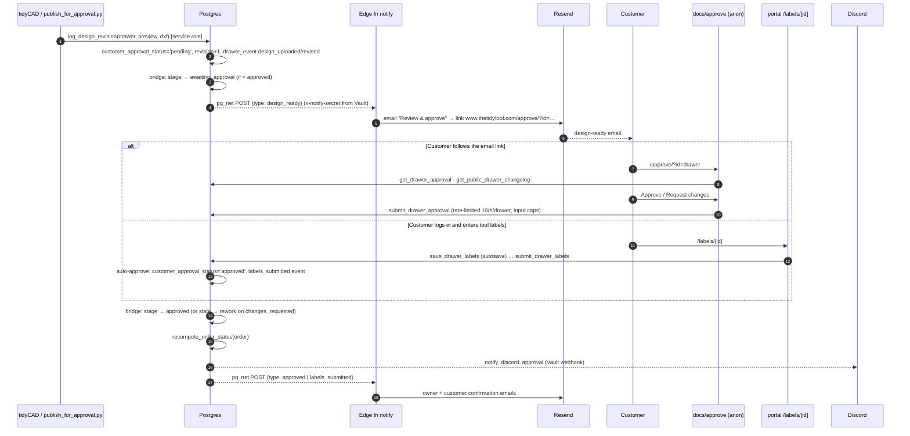
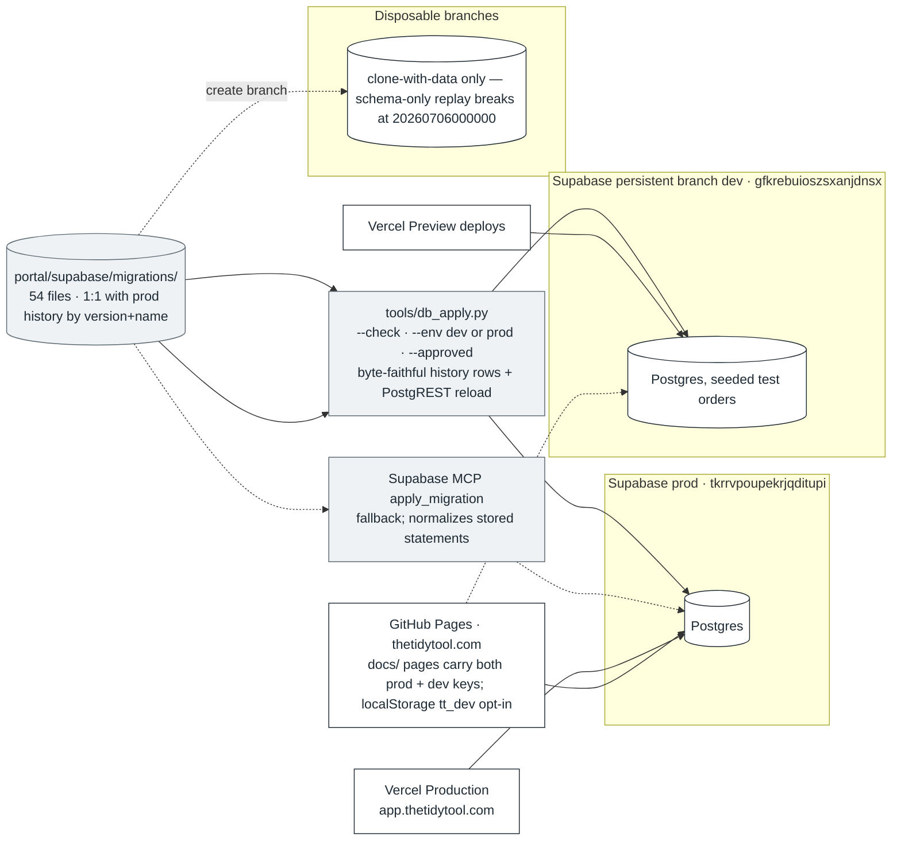

# TidyTool web — system architecture (as built, 2026-09-10)

Companion to `architecture-review-2026-09-10.md`. Everything here is derived from the code
at `main` (`5ec8ec4`) and the prod migration history; nothing is aspirational. Diagrams are
Mermaid (render on GitHub, in VS Code, or at mermaid.live).

Numbers in the notes: 11 static pages, 17 portal routes + 4 server-action modules,
29 components, 54 migrations, 20 tables, ~95 SQL functions (of which ~70 are REST-exposed
RPCs), 1 edge function.

---

## 1. Context — who talks to what

Notes
- The only two things the public can call without a session are the four capability-link
  RPCs (`get_public_drawer`, `get_drawer_approval`, `submit_drawer_approval`,
  `get_public_drawer_changelog`) and the Tally form. The drawer UUID is the capability.
- `notify` is reached only from Postgres (`pg_net`), never from the app; the app has no
  email code of its own.
- `qr_url` is a generated column — `https://thetidytool.com/q/?d={drawer_id}` — engraved into
  foam. `docs/q/index.html` is a permanent redirect shim to `drawer.html?d=`. Do not move it.

---

## 2. Portal — routes, actions, libraries

```mermaid
flowchart TB
  classDef route fill:#ffffff,stroke:#1e2a33,color:#1e2a33
  classDef client fill:#fff7e6,stroke:#a85c12,color:#1e2a33
  classDef action fill:#e7f6ec,stroke:#1e7e45,color:#1e2a33
  classDef lib fill:#eff2f5,stroke:#5b6870,color:#1e2a33
  classDef db fill:#fdf0ee,stroke:#e8312a,color:#1e2a33

  mw[middleware.ts<br/>session refresh; public = /login, /auth/*]:::lib

  subgraph CustomerRoutes["Customer routes"]
    home["/ dashboard (RSC)"]:::route
    login["/login (client)"]:::client
    setpw["/set-password (client)"]:::client
    confirm["/auth/confirm (route)"]:::route
    labels["/labels/[id] (RSC)"]:::route
    approveP["/approve/[id] (RSC) — orphan, no inbound link"]:::route
  end

  subgraph AdminRoutes["Admin routes — layout requires is_admin or is_staff"]
    aLayout["/admin layout"]:::route
    aHome["/admin pipeline"]:::route
    aQueue["/admin/queue"]:::route
    aOrders["/admin/orders"]:::route
    aOrder["/admin/orders/[id]"]:::route
    aDxf["/admin/orders/[id]/dxf (route)"]:::route
    aCust["/admin/customers ·admin·"]:::route
    aOrg["/admin/organizations ·admin·"]:::route
    aEmp["/admin/employees ·admin (RPC only)·"]:::route
    aHist["/admin/history ·admin·"]:::route
    aAcc["/admin/accuracy ·admin·"]:::route
  end

  subgraph ServerActions["Server actions (use server)"]
    act["admin/actions.ts (32 exports)<br/>CRM · orders · drawers · roles · order/drawer state"]:::action
    box["box-actions.ts"]:::action
    quote["quote-actions.ts<br/>priceQuote → save_quote"]:::action
    site["site-actions.ts<br/>address + miles"]:::action
  end

  subgraph Lib["lib/"]
    sClient["supabase/server.ts<br/>cookie client (RSC, actions, routes)"]:::lib
    bClient["supabase/client.ts<br/>browser client"]:::lib
    aClient["supabase/admin.ts<br/>service role — dynamic import in actions only"]:::lib
    authL["supabase/auth.ts getClaims()"]:::lib
    req["require-admin.ts requireAdminPage()"]:::lib
    types["types.ts (hand-written RPC row types)"]:::lib
    pricing["pricing/ config · engine · normalize · quickbooks<br/>(36 unit tests)"]:::lib
    labelsL["labels.ts DXF pocket parser"]:::lib
    dxf["dxf.ts"]:::lib
    dist["distance.ts (Google)"]:::lib
  end

  pg[(Supabase Postgres<br/>RPCs)]:::db
  authS[(Supabase Auth)]:::db
  store[(Storage)]:::db

  mw --> home & labels & aLayout
  home -->|get_my_drawers · get_my_label_status<br/>get_order_tracker ×N| sClient
  labels -->|get_drawer_labels| sClient
  labels -.->|LabelEditor: save/submit labels, corners| bClient
  approveP -.->|ApprovalForm: submit_drawer_approval| bClient
  login -.->|signInWithPassword · resetPasswordForEmail| bClient
  setpw -.->|updateUser| bClient
  confirm -->|verifyOtp / exchangeCodeForSession| sClient
  aLayout -->|is_admin · is_staff| sClient
  aHome -->|get_status_pipeline · get_admin_pipeline<br/>orphans · customers| sClient
  aHome -.->|StatusPipeline realtime status_event| bClient
  aQueue -->|get_work_queue| sClient
  aOrders -->|get_admin_orders| sClient
  aOrder -->|get_admin_order_detail · get_quotes_for_order<br/>pricing_config| sClient
  aOrder --> act & box & quote & site
  aDxf -->|is_staff · get_admin_order_detail| sClient
  aDxf --> store
  aCust & aOrg & aHist & aAcc --> req
  aCust --> act
  aEmp --> act
  aAcc -.->|CalibrationAccuracy realtime drawer| bClient
  act --> sClient
  act -->|invite · createUser · listUsers · updateUserById| aClient
  box & quote & site --> sClient
  site --> dist
  quote --> pricing
  quote -->|drawer · box · pricing_config reads| sClient
  sClient & bClient --> pg
  sClient --> authS
  aClient --> authS
  authL --> sClient
  req --> sClient
```

Notes
- Every mutation goes through an RPC that re-checks `is_admin()` / `is_staff()` in SQL; the
  page-level guards (`requireAdminPage`, layout redirect) are UX, not the security boundary.
- Four server actions (`invitePortalUser`, `createPortalLoginWithPassword`,
  `setEmployeePassword`, `addEmployee`) check the role locally *before* touching the
  service-role client. All others rely on the RPC guard — which is fine except where an
  action does paid work first (`lookupOrderDistanceAction`, review P-3).
- Component tree (edges that matter): `OrderContents → {BoxCard, DrawerBoxControls,
  DrawerQuickView → ScanViewer(three.js, lazy)}`, `QuotesSection → CustomerBreakdown`,
  `CustomersList → PortalAccess`, `OrderStateControls/EditOrderModal → Modal + ConfirmButton`,
  `OrdersTable → DesignProgress`, `page.tsx → OrderTracker`, `labels/[id] → LabelEditor`.

---

## 3. Data model (public schema, final state after `20260910175529`)

Not shown (dead or vestigial): `employee` (1 row, readable by every signed-in user, referenced
by nothing), `drawer_backup_2026_05_02` (96 rows), `_archive_customer_2026_07_03` (20 rows),
view `order_capture_quality`, columns `drawer.capture_quality*` (written by
`set_capture_quality`, read by nothing in this repo).

---

## 4. Status backbone — the drawer state machine

Order `computed_status` is **derived and stored** by `recompute_order_status()` from the
non-cancelled drawers, evented as `kind='recompute'`:

| rule | condition on active drawers | order status |
|---|---|---|
| R0 | none | received |
| R1 | all delivered | delivered |
| R2 | min stage ≥ ready | ready |
| R3 | any ≥ in_production | production |
| R4 | min ≥ approved | approved |
| R5 | any awaiting_approval | awaiting_approval |
| R6 | max ≥ design_queue | design |
| R7 | max ≥ scanned | scanning |
| R8 | otherwise | received |

Effective order status shown to customers = `coalesce(manual_status, computed_status)`;
`order.state` (hold/cancel) is a separate axis. Recompute fires on drawer INSERT/UPDATE of
`stage/state/order_id` — **not on DELETE** (review D-3).

Writers of `drawer.stage`: `set_drawer_stage` RPC (legal transitions from
`status_transition`, admin corrections), the bridge trigger (legacy `status` enum from
tidyCAM/tidyCAD, `customer_approval_status`, new `design_preview_url`), `mark_drawer_delivered`
(correction), and — because `drawer_update_staff` is a full-row policy — any direct UPDATE by a
staff session, which records no event (review D-4).

---

## 5. Approval + notification flow (as it runs today)

The two branches are both live and give the customer different instructions (email says
"review & approve", the portal says "submitting labels is your go-ahead"). They converge on
the same columns, so data stays consistent; the product story does not (review M-1).

---

## 6. Environments and the migration path

Contract surfaces that other repos depend on (do not change without cross-repo coordination):
`drawer.qr_url` expression and `docs/q/`, the `/approve/?id=` URL + the four public RPC
signatures, `drawer.id` as capability token, `drawer_status` enum values, `status_def` codes,
`status_event.source` values, `record_dxf_upload` / `record_scan_correction` /
`revert_scan_correction` / `set_drawer_stage` / claims + progress RPCs / `set_capture_quality`
/ `set_order_customer_email` / box RPC signatures, `order.total_price` in cents,
`order.drawer_ids` text, and the `notify` payload `{type, …}` + `x-notify-secret`.
